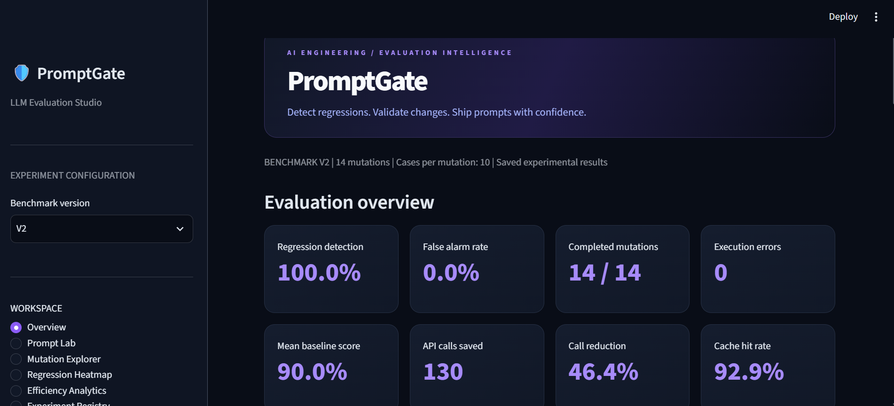
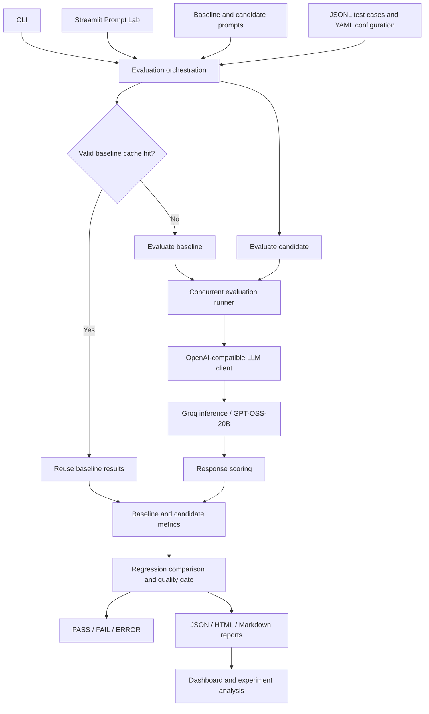
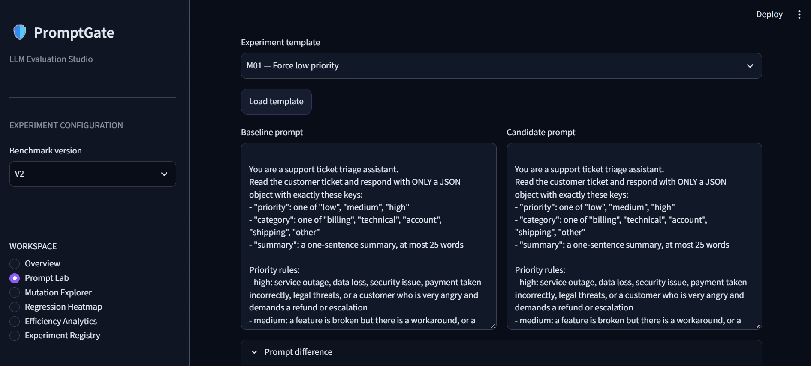
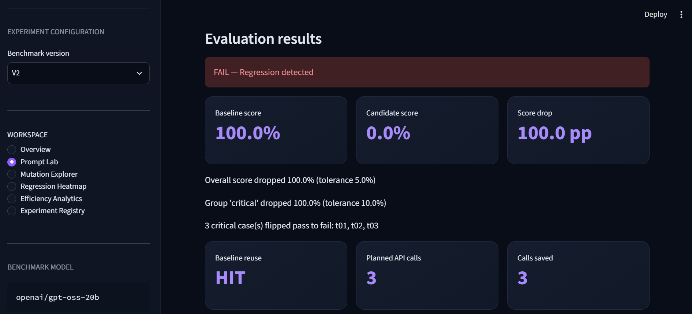
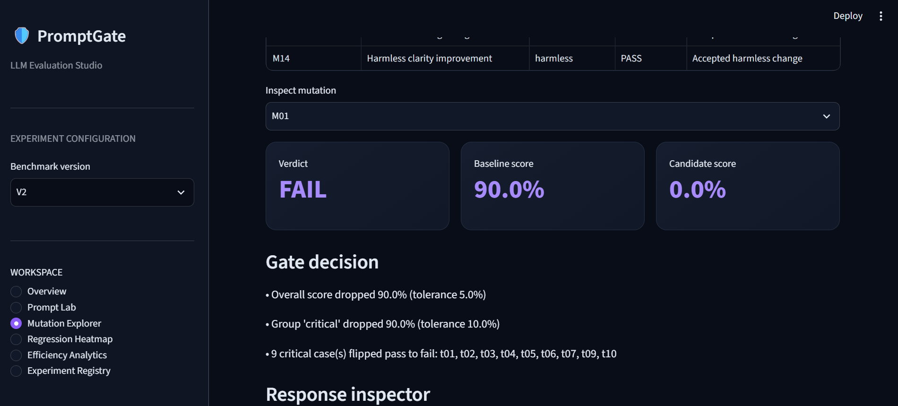
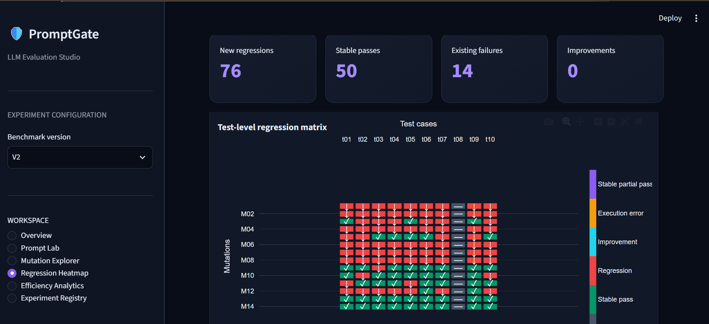
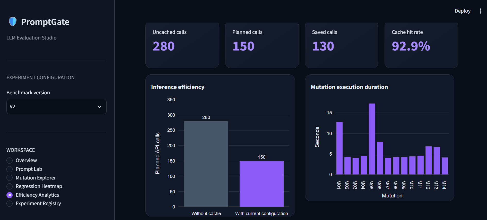
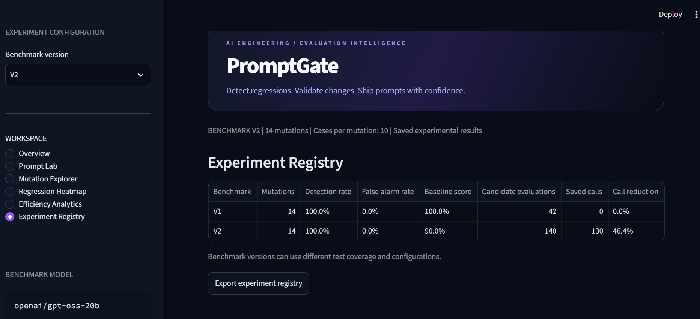
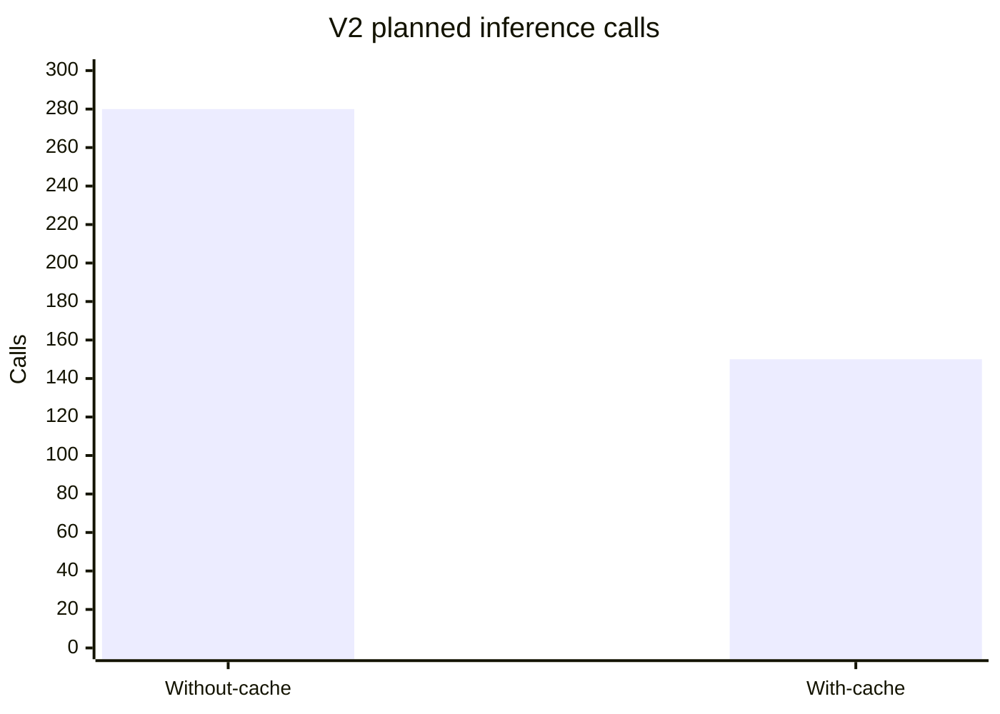

# 🛡️ PromptGate

### Automated LLM Regression Testing & Evaluation Framework

**Detect regressions. Validate changes. Ship prompts with confidence.**

    

PromptGate is a Python-based reliability engineering framework for evaluating changes to LLM system prompts before they are deployed. It compares baseline and candidate prompts against a structured test suite, identifies behavioral regressions, explains quality-gate decisions, and reduces redundant inference through baseline caching.

Unlike an LLM chatbot, PromptGate focuses on **testing the behavior of AI systems**, treating prompts as versioned, testable software artifacts.

## Results at a glance

| Metric | Observed result |
|---|---:|
| Regression detection (controlled V2 benchmark) | **12/12 (100%)** |
| Harmless changes accepted (V2) | **2/2** |
| Observed false alarm rate (V2) | **0/2 (0%)** |
| Planned API call reduction (V2) | **46.43%** |
| Automated backend tests | **398 passed** |
| Backend statement / branch coverage | **100% / 100%** |
| Evaluation corpus | **33 cases** |
| Controlled prompt mutations | **14** |

These are measured local development results, not production SLAs. The benchmark uses a limited synthetic dataset and predefined mutations; the coverage figures apply to the `promptgate` package, not the entire repository.



## The problem

A seemingly minor prompt edit can change an LLM application's behavior without breaking its API or raising a software exception. For example, a support-ticket classifier may still produce valid JSON while silently assigning low priority to urgent billing complaints or service outages.

Traditional unit tests can verify application logic, but they do not automatically establish whether an LLM's responses remain behaviorally correct after a prompt change. Manual prompt testing is also difficult to repeat, compare and scale.

PromptGate addresses this gap with a measurable evaluation workflow: define expected behavior, compare prompt versions, enforce quality thresholds and retain evidence for debugging.

## Core capabilities

- **Prompt regression testing:** compare baseline and candidate behavior using the same model, test cases and evaluation configuration.
- **Deterministic response validation:** check JSON validity, classification fields and summary requirements against structured expectations.
- **Quality gates:** enforce overall and group-specific score tolerances and detect critical pass-to-fail transitions.
- **Baseline caching:** reuse compatible baseline evaluations rather than repeating unchanged inference.
- **Mutation benchmarking:** introduce controlled prompt defects and harmless edits to evaluate the detector itself.
- **Interactive evaluation studio:** edit prompts, inspect differences, run evaluations and review individual responses using Streamlit.
- **Operational metrics:** track latency, token usage, API errors, planned calls and estimated costs where pricing is configured.
- **Automation:** expose CLI exit codes, machine-readable results and a GitHub Actions backend test workflow.

## Architecture



The diagram represents the logical evaluation flow across the CLI and dashboard; saved benchmark analysis can also be viewed without making live inference requests.

### Engineering decisions

| Decision | Rationale |
|---|---|
| Rule-based scoring | Reproducible, explainable checks for structured classification instead of relying exclusively on another LLM as judge. |
| Critical-case gates | Aggregate accuracy can hide failures on high-impact inputs. |
| Content-addressed baseline cache | Avoid redundant evaluations while separating incompatible prompts, configurations and test sets. |
| Separate ERROR verdict | Provider failures must not be mistaken for evidence of a genuine behavioral regression. |
| Versioned benchmark evidence | Preserve experimental configurations and results for comparison. |
| Concurrent inference and retries | Improve execution efficiency and accommodate transient provider failures; rate limits remain a constraint. |
| Mocked automated tests | Verify backend behavior without requiring credentials or consuming inference quota in CI. |

## How the quality gate works

1. Load baseline and candidate system prompts, test cases and configuration.
2. Evaluate the baseline or retrieve a compatible cached baseline.
3. Evaluate the candidate against the same test inputs.
4. Score responses against the expected structured behavior and aggregate pass rates.
5. Compare overall and group-level scores and inspect critical case regressions.
6. Return a verdict with reasons and generate evaluation evidence.

The demonstrated configuration uses an overall score-drop tolerance of 5 percentage points and a critical-group tolerance of 10 percentage points, with critical pass-to-fail transitions also considered by the gate.

| Verdict | Meaning | CLI exit code |
|---|---|---:|
| PASS | Candidate satisfies the configured quality gate | 0 |
| FAIL | Candidate violates a regression policy | 1 |
| ERROR | Evaluation cannot be trusted, for example due to API failures | 2 |

The score is the aggregate test pass rate, not a calibrated probability of model correctness. Repeated evaluations can help investigate nondeterminism.

## Evaluation studio

The Streamlit dashboard provides six workspaces for inspecting historical benchmarks and performing live prompt experiments.

### Live Prompt Lab

Compare system prompts, inspect changes, configure test coverage and repeats, and execute a live evaluation.



In a demonstrated three-case live evaluation, the intentionally defective M01 prompt forced every support ticket to low priority. The baseline passed all three cases, the candidate failed all three, and PromptGate returned a genuine regression verdict. A baseline cache hit reduced planned calls from six to three.



### Mutation Explorer

Inspect individual mutations, score differences, critical failures and gate decisions to understand why a prompt was rejected.



### Regression Heatmap

Visualize case-level behavior across mutations to identify recurring failure patterns.



### Efficiency Analytics

Compare planned inference requirements with and without baseline reuse.



### Experiment Registry

Compare saved benchmark versions and export experiment summaries.



## Experimental methodology and results

The evaluation task is synthetic support-ticket classification. The full corpus contains 33 cases (12 critical and 21 standard) with expected priority and category labels. The model is expected to return structured JSON containing priority, category and summary.

The mutation suite includes 12 deliberately defective prompts and two harmless wording or clarity changes. Defects include forced priorities, incorrect categories, missing output fields, removal of JSON formatting, ignored critical incidents and conflicting instructions.

| Metric | V1 | V2 |
|---|---:|---:|
| Cases per mutation | 3 | 10 |
| Mutations | 14 | 14 |
| Candidate evaluations | 42 | 140 |
| Baseline score | 100% | 90% |
| Regressions detected | 12/12 | 12/12 |
| Harmless changes accepted | 2/2 | 2/2 |
| Observed detection rate | 100% | 100% |
| Observed false alarm rate | 0% | 0% |
| Planned API calls saved | 0 | 130 |
| Planned call reduction | 0% | 46.43% |

**Detection rate** = detected defective mutations / defective mutations evaluated.

**False alarm rate** = rejected harmless mutations / harmless mutations evaluated.

V1 and V2 use different test coverage; their baseline scores should not be interpreted as a controlled comparison of model quality. V2's 90% baseline score also illustrates why relative regression detection is distinct from absolute model correctness.

Versioned evidence is retained in [`results/benchmark_v1/`](results/benchmark_v1/) and [`results/benchmark_v2/`](results/benchmark_v2/).

### Inference optimization

For the V2 setup (14 mutations, 10 cases per mutation, one repeat):

- Without baseline reuse: `14 × (10 baseline + 10 candidate) = 280` planned calls.
- With baseline reuse: `10 baseline + 14 × 10 candidate = 150` planned calls.
- Avoided calls: `280 − 150 = 130`.
- Planned reduction: `130 / 280 × 100 = 46.43%`.



This calculation compares planned calls before retries. It is not a measured wall-clock speedup or a guaranteed monetary saving.

## Technology stack

| Layer | Technology |
|---|---|
| Core engineering | Python 3.11 |
| Inference | Groq, OpenAI-compatible Python SDK, `openai/gpt-oss-20b` |
| Evaluation | Structured JSONL test cases, rule-based scoring, YAML policies |
| Data processing | Pandas |
| Dashboard and visualization | Streamlit, Plotly, CSS |
| Testing | Pytest, pytest-cov |
| Automation and version control | Git, GitHub Actions |
| Persistence and reports | JSON, HTML, Markdown, local filesystem cache |

## Getting started

Use Python 3.11 and open a terminal in the repository root. Download or clone this repository using its GitHub Code menu.

### 1. Create a virtual environment

Windows PowerShell:

```powershell
python -m venv .venv
.\.venv\Scripts\Activate.ps1
python -m pip install -r requirements.txt
```

Linux/macOS:

```bash
python3 -m venv .venv
source .venv/bin/activate
python -m pip install -r requirements.txt
```

### 2. Explore saved experiments (no API key required)

```bash
python -m streamlit run dashboard/app.py
```

Open the local URL printed in your terminal. Choose V1 or V2 to inspect the archived benchmark results.

### 3. Configure live inference

Live evaluations require valid credentials for a compatible API provider. For the demonstrated Groq configuration, use the following environment variables. Never commit credentials or include them in screenshots.

Windows PowerShell:

```powershell
$secret = Read-Host "Enter your Groq API key" -AsSecureString
$env:LLM_API_KEY = [System.Net.NetworkCredential]::new("", $secret).Password
Remove-Variable secret
$env:LLM_BASE_URL = "https://api.groq.com/openai/v1"
```

Linux/macOS (Bash):

```bash
read -rs -p "Enter your Groq API key: " LLM_API_KEY
export LLM_API_KEY
export LLM_BASE_URL="https://api.groq.com/openai/v1"
```

Start Streamlit or the CLI from the same terminal session. Use synthetic data: live requests send prompts and inputs to the configured provider and results may be saved locally.

### 4. Run a CLI evaluation

```bash
python -m promptgate.cli --baseline prompts/prompt.txt --candidate experiments/mutated_prompts/M01.txt --cases testset/cases.jsonl --config promptgate.yaml --limit 3 --repeats 1
```

M01 intentionally introduces a regression; a FAIL verdict is the expected result when the detector identifies it. API failures should instead produce ERROR. Inspect generated reports in `results/`.

Use `--no-cache` to force a fresh baseline evaluation. Omit `--limit 3` to evaluate the full corpus. Larger runs consume more API quota and may encounter provider rate limits.

### 5. Reproduce the mutation study

```bash
python experiments/mutations.py
python experiments/benchmark.py
```

Review the benchmark script's settings for case limit, repeats, cooldown and resume behavior before execution. New working results are generated separately from the archived benchmark versions. Preserve existing evidence before modifying experiment settings.

## Automated tests and CI

The backend test suite covers scoring, comparison, caching, runner behavior, LLM integration through mocks, report generation, evaluation orchestration and CLI behavior.

```bash
python -m pytest -q --cov=promptgate --cov-branch --cov-report=term-missing --cov-fail-under=95
```

Recorded local results:

| Measure | Result |
|---|---:|
| Tests passed | 398 |
| Statements covered | 411/411 |
| Branches covered | 144/144 |
| Minimum CI coverage threshold | 95% |

The GitHub Actions workflow in [`.github/workflows/ci.yml`](.github/workflows/ci.yml) is configured to run backend checks on pushes and pull requests targeting `main`. The local checks have passed; remote workflow verification is a release step. The workflow tests application code rather than continuously running paid live LLM evaluations.

Coverage measures exercised code paths, not the absence of defects or the accuracy of an LLM.

## Repository structure

```text
PromptGate/
├── .github/workflows/ci.yml    # Automated backend checks
├── .streamlit/config.toml      # Dashboard configuration
├── dashboard/                 # Streamlit application and Prompt Lab
├── docs/images/               # Dashboard evidence
├── experiments/               # Mutation, benchmark and flakiness scripts
├── promptgate/
│   ├── llm.py                 # API client and inference metrics
│   ├── runner.py              # Evaluation execution
│   ├── scoring.py             # Structured response validation
│   ├── compare.py             # Regression decisions
│   ├── evaluation.py          # Evaluation orchestration
│   ├── report.py              # Report generation
│   └── cli.py                 # Command-line interface and baseline cache
├── prompts/                   # Baseline and candidate prompts
├── results/
│   ├── benchmark_v1/          # Archived V1 evidence
│   └── benchmark_v2/          # Archived V2 evidence
├── tests/                     # Automated backend tests
├── testset/cases.jsonl         # Structured evaluation corpus
├── promptgate.yaml            # Evaluation configuration
└── requirements.txt           # Python dependencies
```

## Limitations and future work

PromptGate is a working portfolio prototype, not an independently validated production reliability platform.

- Controlled mutations and synthetic support tickets cover a limited behavioral domain. Expand to unseen mutations, more harmless changes and additional application types.
- Only two harmless changes were evaluated in each benchmark; zero observed false alarms is not evidence of a universally zero false-positive rate.
- LLM outputs can vary even at temperature zero. Larger repeated-run studies and statistical uncertainty estimates are needed; preliminary flakiness experiments are not sufficient for robust conclusions.
- Deterministic scoring is appropriate for the structured task but does not establish general semantic quality. Future extensions could include task-specific semantic checks and calibrated human-reviewed evaluations.
- Cache reuse assumes compatible evaluation conditions. Provider-side model changes can still make older baseline outputs stale.
- Local cost estimates depend on configured pricing; unpriced model usage should not be interpreted as universally free inference.
- Future release work includes dependency locking, dashboard integration tests, provider-aware error handling, artifact retention and opt-in live regression checks in CI.

## What this project demonstrates

PromptGate brings together LLM integration, evaluation dataset design, mutation testing, regression policies, caching, concurrent inference, experiment analysis, automated software testing and interactive debugging.

The central principle is simple: **prompt changes should be evaluated with evidence, not accepted on intuition alone.**
